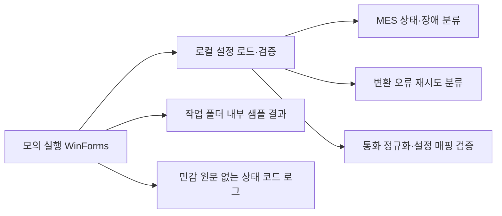

# 공개 샘플 구조와 면접 설명

운영 데이터나 내부 토폴로지를 표현하지 않는 코드 책임 구성도입니다.

## 초기 → 입력 → 검증 → 처리 → 결과 → 예외

1. **초기:** 설정을 읽습니다. 파일이 없거나 깨졌을 때는 메모리 기본값으로 복구하고 원본은 유지합니다.
2. **입력:** 인위적인 성공·실패 결과와 공개용 통화 코드를 사용합니다. 실제 업무 데이터가 아닙니다.
3. **검증:** 출력 폴더 이름, 수치 범위, 통화 매핑과 상태 전이를 확인합니다.
4. **처리:** 업로드 상태·장애 분류, 회로 차단, 변환 재시도 정책을 실행합니다.
5. **결과:** 화면에 모의 실행 결과를 안내하고 고정 로그 코드만 기록합니다.
6. **예외:** 파일 없음·잠금·권한·형식 오류를 구분합니다. 사용자 취소는 정상 취소로 전달하며 프로그램이 계속 동작할 수 있게 I/O 오류를 안내합니다.

## MES 연계에서 중요한 판단

MES 응답 시간이 초과됐다는 이유만으로 실패를 확정하고 즉시 재전송하면, 서버에서 이미 처리한 작업을 중복 반영할 수 있습니다. 상태 모델은 성공·확정 실패·응답 불명확을 구분합니다. 공개 샘플은 이 판단과 회로 차단의 복구 시험을 보여줍니다. 영속 재시도 큐·외부 MES 호출·작업 예약 DB 구현은 포함하지 않으므로 전체 시스템의 중복 방지를 재현한다고 주장하지 않습니다.

`UploadStateMachine`은 원래 호출 순서를 설명하는 단일 작업 모델입니다. 동시 작업 배제·영속 상태 저장을 제공하지 않습니다. 실제 시스템에서는 작업 예약·호출 제어·이력과 함께 적용해야 합니다.

## 변환·업무 데이터 검증

모든 파일 오류를 같은 간격으로 재시도하면 형식 오류나 설정 오류가 반복됩니다. `RetryPolicy`는 어떤 변경이 있어야 다시 처리할 수 있는지 분류합니다. 취소는 이 정책에서 다시 시도하지 않습니다.

통화 매핑은 데이터 정규화와 DB 식별값의 책임을 나눕니다. 공개 설정의 `USD_DEMO` 등은 설명용 값이며 실제 사내 DB의 번호가 아닙니다. SQL 실행 코드는 포함하지 않습니다. 실제 DB 연결을 추가할 때는 파라미터 SQL과 최소 권한, 환경변수 또는 OS 보안 저장소를 통해 주입한 인증정보를 사용해야 합니다.

## 유지보수 시 주의

- WinForms 이벤트는 Designer에 연결하고 로직은 MainForm에서 처리합니다. 이벤트를 다른 이벤트에서 우회 호출하지 않습니다.
- 장애 분류·복구 경계 변경 시 시간 주입 테스트와 동시 복구 시험을 함께 실행합니다.
- 공개 설정에는 인증정보를 추가하지 않습니다. 로그에 예외 원문이나 업무 키를 넣지 않습니다.
- 자동 삭제 기능은 없습니다. 기존 파일을 지우지 않고 샘플 결과마다 고유 파일을 생성합니다.
- [주의] 출력 경로는 문자열과 하위 경로를 검증합니다. 쓰기 권한이 있는 로컬 사용자에 의한 작업 폴더 재배치·재분석 지점 조작을 방어하는 보안 경계로 쓰면 안 됩니다.
